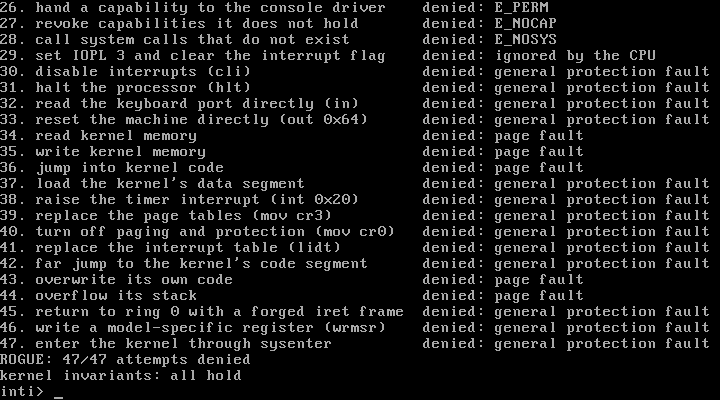
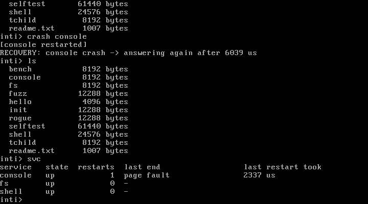
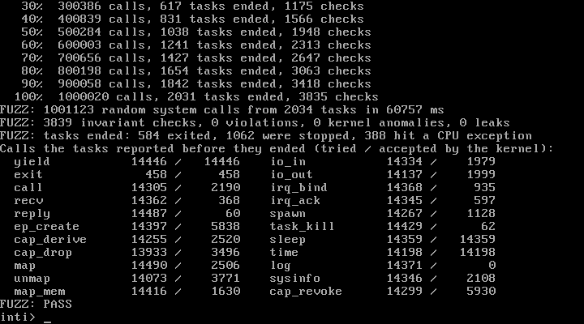
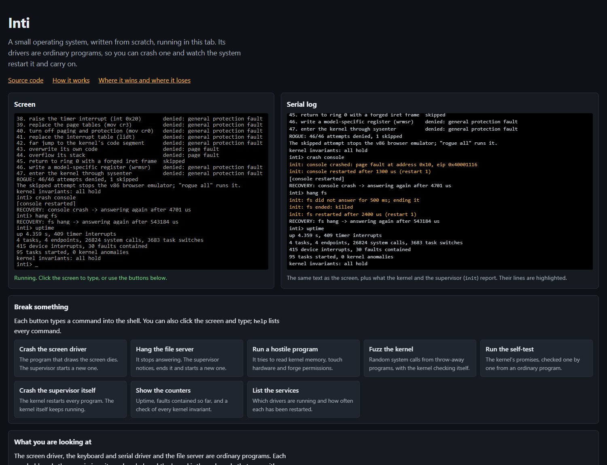

# Inti: review dossier

This file is generated by `tools/dossier.py` from the repository. It contains the four documents as rendered by `tools/claims.py`, pieces of the source code copied verbatim, and the raw measurements behind the summary figures. Links and images are relative to the repository.

| Item | Value |
|---|---|
| Gate run | 2026-11-10T19:37:59+07:00 (full run) |
| Gates passed | 9 of 9 |
| Disk image, SHA-256 | `6a8137a0704dd8ee1a8e524007786cd56fda9068d05128da12424693108d4b5d` |
| Image tested in QEMU | `6a8137a0704dd8ee1a8e524007786cd56fda9068d05128da12424693108d4b5d` |
| Image tested in the browser | `6a8137a0704dd8ee1a8e524007786cd56fda9068d05128da12424693108d4b5d` |
| Emulator | QEMU 11.1.0 (TCG, no hardware virtualisation) |
| Toolchain | rustc 1.99.1 (58cf8f9c3 2026-10-13); Python 3.13.2 |

---

# Document: `README.md`

## Inti

**A small operating system, written from scratch, that you can break on purpose.**

Inti (Indonesian for "core") is a boot sector, a capability microkernel of 2,673 lines of Rust, and device drivers that run as ordinary programs. It was built to take three well-documented weaknesses of mainstream operating systems, do the opposite, and measure what happens.

**[Try it in your browser](https://juw12.github.io/inti/)**. There is nothing to install: the page boots the same disk image that the tests boot in QEMU, and it has buttons that crash a driver, hang the file server, run a hostile program and fuzz the kernel.

Inti is not the best operating system in the world, and nothing here says so. It is a research toy: no network, no disk file system, no applications, one processor, and it has only ever run in emulators. [The scorecard](docs/scorecard.md) shows where Linux, Windows, seL4, MINIX 3 and Redox are ahead, which is nearly everywhere outside the three points below.

| A hostile program is denied | A driver fails and is replaced |
|---|---|
|  |  |

| The kernel is fuzzed | The same disk image in a browser tab |
|---|---|
|  |  |

These are captures of the emulated screen, taken by the test scripts during the run that produced the numbers below.

### Three weaknesses, and what Inti does instead

| Weakness of mainstream systems | What Inti does | Measured on this build |
|---|---|---|
| **A driver bug takes the whole system down.** Drivers run inside the kernel. Device drivers caused 85% of recently reported Windows XP failures ([Swift, Bershad and Levy, SOSP 2003](https://dl.acm.org/doi/10.1145/945445.945466)), and on 19 July 2024 one faulty update for a kernel driver crashed an estimated 8.5 million Windows devices ([Microsoft](https://blogs.microsoft.com/blog/2024/07/20/helping-our-customers-through-the-crowdstrike-outage/)). | Drivers are ordinary programs with no kernel privileges. A supervisor restarts a driver that crashes or stops answering, and programs that were waiting get their answer from the new one. | A crashed console driver answers again after 5.8 ms (median of 5 runs), a hung one after 657 ms. When the supervisor itself is crashed, the kernel restarts user space. |
| **Kernels are written in memory-unsafe languages.** About 70% of the vulnerabilities Microsoft assigns a CVE each year are memory-safety issues ([MSRC, 2019](https://www.microsoft.com/en-us/msrc/blog/2019/07/a-proactive-approach-to-more-secure-code)); Chromium reports the same share of its high-severity bugs ([Chromium](https://www.chromium.org/Home/chromium-security/memory-safety)). | The kernel is Rust with no heap: every table has a fixed size. Each of its 37 `unsafe` blocks carries a written justification, and a checker inside the kernel recounts everything the kernel owns against 21 rules. | 1,001,123 random system calls from 2,034 throw-away programs: 0 rule violations in 3,839 checks, 0 kernel anomalies, 0 leaked resources. |
| **Programs run with all the rights of their user.** A program that acts with the full power of its user can reach everything that user can; Watson and others call such implicit access ambient authority ([Capsicum, USENIX Security 2010](https://www.usenix.org/legacy/event/sec10/tech/full_papers/Watson.pdf)). | There is no ambient authority. Every system call starts from a capability the program was handed, and a capability can be narrowed but never widened. | A hostile program that holds one capability makes 47 attempts on the kernel, the hardware and other programs. 47 are denied and the system stays up. |

None of these ideas is new: MINIX 3 restarts user-mode drivers, seL4 is a capability kernel with proofs, Redox is a microkernel system in Rust. Inti is a small system that combines them and shows its evidence. [Weaknesses and sources](docs/weaknesses.md) has the details and what Inti does not solve.

### What was measured

`python build.py gates` builds from a clean tree, runs every test in QEMU, boots the same image in a headless browser and checks these documents. Result of 2026-11-10 (QEMU 11.1.0 (TCG, no hardware virtualisation) on Windows 10): **9 of 9 gates pass.**

| Gate | Requirement | Result | Measured |
|---|---|---|---|
| G1 | One command builds the disk image from a clean tree | pass | clean build in 50 s wrote build/inti.img (2,097,152 bytes) |
| G2 | Boots from its own boot sector to a shell prompt in QEMU within 20 s | pass | shell prompt 264 ms after QEMU started; the image begins with Inti's own boot sector (signature 55 AA); no multiboot header and no GRUB in boot sector or kernel |
| G3 | The self-test inside the system passes with at least 30 checks | pass | SELFTEST: PASS 82/82 after boot and 82/82 again after every injected fault and the fuzz run |
| G4 | Each supervised service is crashed and hung, restarted automatically, and timed | pass | console crash 5.8 ms, fs crash 2.7 ms, console hang 657.0 ms, fs hang 647.1 ms (median of 5 runs each, guest clock); the shell answered after every run |
| G5 | Every attempt of the hostile program without capabilities is denied | pass | 47/47 attempts denied (port I/O 3, interrupts 5, physical memory 1, kernel memory 4, other tasks 2, forged capabilities 4, forged tokens 1); the kernel invariants hold and the shell still answers |
| G6 | At least 1,000,000 random system calls: no kernel panic, no invariant violated | pass | 1,001,123 random system calls from 2,034 tasks, 3,839 invariant checks, 0 violations, 0 kernel anomalies, no kernel panic in the serial log |
| G7 | No heap in the kernel, every unsafe justified, at most 4,000 lines of kernel code | pass | no alloc crate in the kernel; 75 uses of unsafe in kernel, boot sector and programs, each with a SAFETY comment; 2,673 lines of kernel code (limit 4,000) |
| G8 | The same disk image boots to the shell prompt in a web browser | pass | shell prompt after 2.46 s in v86 0.5.473 (WebAssembly) under chromium 157.0.4341.42 (headless); 6 commands answered; byte-for-byte the image of the QEMU test |
| G9 | Every number in the documents comes from a script or carries a source | pass | tools/check_claims.py passes: claims recomputed, documents re-rendered and compared |

All timings are emulator timings. They show that a restart is quick compared with a reboot; they say nothing about real hardware, which Inti has never run on.

A driver crash, exactly as the serial port recorded it:

```log
inti> crash console
init: console crashed: page fault at address 0x10, eip 0x40001116
init: console restarted after 2337 us (restart 1)
[console restarted]
RECOVERY: console crash -> answering again after 6039 us
```

The hostile program (a sample; `...` marks lines left out, and the full list is in [weaknesses and sources](docs/weaknesses.md)):

```log
inti> rogue all
Starting a hostile program that holds one capability: console output.
Attempts that need a capability are made with each of the 32 slots.
 1. read the keyboard port 0x60                denied: E_NOCAP
 2. reset the machine through port 0x64        denied: E_NOCAP
 3. take over the keyboard interrupt           denied: E_NOCAP
 4. map physical memory                        denied: E_NOCAP
 5. kill another task                          denied: E_NOCAP
...
 9. add the receive right to its console cap   denied: E_PERM
...
11. answer others' calls with forged tokens    denied: E_INVAL
...
15. have the kernel write into kernel memory   denied: E_FAULT
...
20. take more memory than its quota            denied: E_NOMEM
...
24. create an endpoint with no endpoint quota  denied: E_NOSLOT
25. give a child more task quota than it has   denied: E_NOSLOT
26. hand a capability to the console driver    denied: E_PERM
27. revoke capabilities it does not hold       denied: E_NOCAP
...
30. disable interrupts (cli)                   denied: general protection fault
...
34. read kernel memory                         denied: page fault
35. write kernel memory                        denied: page fault
...
39. replace the page tables (mov cr3)          denied: general protection fault
...
45. return to ring 0 with a forged iret frame  denied: general protection fault
...
ROGUE: 47/47 attempts denied
kernel invariants: all hold
```

### Try it

In the browser: open the [live demo](https://juw12.github.io/inti/) and press the buttons, or click the screen and type.

On your own machine, with QEMU installed, `python build.py run` builds the image and boots it in a window (`run.bat` does the same on Windows). Things to type at the `inti>` prompt:

| Command | What happens |
|---|---|
| `help` | lists every command |
| `crash console` | the screen and keyboard driver dies of a page fault; the supervisor replaces it and the shell prints how long that took |
| `hang fs` | the file server stops answering; the supervisor notices, ends it and starts a new one |
| `rogue` | a hostile program tries to read kernel memory, touch hardware, forge or revoke capabilities and exceed its quotas |
| `fuzz 20000` | random system calls from throw-away programs while the kernel checks its own rules |
| `selftest` | 82 promises of the kernel, checked one by one from an ordinary program |
| `crash init` | the supervisor itself dies; the kernel starts every program again |
| `svc`, `ps`, `caps <task>`, `mem`, `uptime` | what is running, who holds which capabilities and what each was copied from, quotas, memory, counters |

### Build and test

You need Rust with the `i586-unknown-linux-gnu` target, Python 3.9 or newer, and QEMU for everything that runs the image. There is no assembler, no C compiler and no make: the boot sector is written in Rust too.

```
rustup target add i586-unknown-linux-gnu
python build.py          # compile everything and write build/inti.img
python build.py run      # boot the image in a QEMU window
python build.py test     # run every test in QEMU
python build.py gates    # clean build, tests, browser check, document check
```

The browser check also needs Playwright with Chromium (`pip install playwright`, then `playwright install chromium`). The last gate run used rustc 1.99.1 (58cf8f9c3 2026-10-13), Python 3.13.2 and QEMU 11.1.0 (TCG, no hardware virtualisation); its test run took 154 s.

### How it works

- **Boot.** A boot sector of 512 bytes, written in Rust, loads the kernel through the BIOS. No GRUB, no multiboot.
- **Kernel.** 2,673 lines of Rust, 60.2 KiB when built. It hands out memory, switches between tasks, passes messages, checks capabilities and forwards interrupts, through 22 system calls. It has no heap, no drivers and no file system.
- **Capabilities.** A program can only name what it holds: 7 kinds of capability (endpoints, I/O ports, interrupt lines, memory, tasks, the kernel log, kernel information). No system call takes a global name such as a process id or a path. A capability can be copied with fewer rights but never more, passed on in a message when both sides hold the grant right, and revoked: whoever handed it out takes back every copy while the holders keep running.
- **Quotas.** Memory, tasks and endpoints are lent by a parent to its children and returned when they end, so a program can exhaust its own share and nothing else.
- **Drivers.** The console driver (screen, keyboard, serial port) and the file server are ordinary programs, each started with a handful of capabilities.
- **Supervisor.** `init` holds every capability at boot, hands each server the few it needs, and restarts a server that crashes or stops answering. If `init` itself dies, the kernel starts user space again.
- **Self-checking.** `selftest` checks the kernel's promises from user space, the invariant checker inside the kernel recounts every frame, capability and queue, and `fuzz` throws random system calls at the kernel while that checker runs.

[How Inti works](docs/design.md) has the details: the system calls, the supervisor's policy, the invariant rules, what has to be trusted, and the full list of limitations.

### Where it loses

Inti leads only on the narrow things it was built to show, against systems that were built to do far more. It supports no hardware beyond an emulated PC, and it has no network, no persistent storage, no applications and one processor. Its kernel is tested and self-checking but not proven: seL4 is formally verified and Inti is not. MINIX 3 showed restartable user-mode drivers at real scale years ago, and Redox is a Rust microkernel system that runs real programs. The [scorecard](docs/scorecard.md) goes through this point by point.

### About the numbers

No number in these documents is typed by hand unless a source link stands next to it. `tools/claims.py` computes each one from the raw serial log, the test results or the source code and writes it to `evidence/claims.json` together with the file it came from. The documents are rendered from templates in `docs/src/`. `tools/check_claims.py` then recomputes everything and rejects a document that contains a number which is neither computed, nor cited, nor present in the source code; it also compares every line of every log excerpt with the raw log.

### Repository layout

| Path | What is there |
|---|---|
| `boot/` | the boot sector (127 lines) |
| `kernel/` | the kernel (2,339 lines) |
| `abi/` | the interface that the kernel and the programs share (334 lines) |
| `user/` | the runtime library, the supervisor, the drivers, the shell and the test programs (4,327 lines) |
| `build.py`, `tools/` | the build, test, gate and document scripts (2,093 lines of Python) |
| `evidence/` | the raw serial log and every measured number of the last gate run |
| `docs/` | the browser demo, these documents and their templates |
| `rubric.md`, `refine_log.md` | the criteria this project was built against, and the log of the run that built it |

### Licence

MIT, see `LICENSE`. The browser demo uses the [v86](https://github.com/copy/v86) emulator (BSD 2-Clause licence) and the BIOS images that ship with it; see `docs/v86/NOTICE.txt`.

---

# Document: `docs/weaknesses.md`

## The weaknesses Inti targets, with sources

Inti does not try to beat mainstream operating systems at what they are good at. It picks three weaknesses that their own makers and the research literature document, and shows a design in which each one is absent. For each weakness this page gives the evidence, what Inti does, what was measured, and what Inti does **not** solve.

The measurements are from the gate run of 2026-11-10 in QEMU 11.1.0 (TCG, no hardware virtualisation). `python build.py gates` repeats them. They are emulator figures.

### Drivers that can take the whole system down

**The evidence.**

- Device drivers caused 85% of recently reported Windows XP failures ([Swift, Bershad and Levy, "Improving the Reliability of Commodity Operating Systems", SOSP 2003](https://dl.acm.org/doi/10.1145/945445.945466)).
- In Linux, drivers had error rates three to seven times higher than the rest of the kernel ([Chou and others, "An Empirical Study of Operating Systems Errors", SOSP 2001](https://dl.acm.org/doi/10.1145/502034.502042)). Ten years later drivers still contained the most faults, although their fault rate had fallen below that of other directories such as the architecture and file-system code ([Palix and others, "Faults in Linux: Ten Years Later", ASPLOS 2011](https://dl.acm.org/doi/10.1145/1961296.1950401)).
- Microsoft's documentation says of Windows that if a kernel-mode driver crashes, the entire operating system crashes ([Microsoft Learn, "User mode and kernel mode"](https://learn.microsoft.com/en-us/windows-hardware/drivers/gettingstarted/user-mode-and-kernel-mode)).
- On 19 July 2024 a faulty content update for CrowdStrike's kernel driver crashed Windows machines around the world. Microsoft estimated 8.5 million affected devices, less than one percent of all Windows machines ([Microsoft, 20 July 2024](https://blogs.microsoft.com/blog/2024/07/20/helping-our-customers-through-the-crowdstrike-outage/)). CrowdStrike's analysis: a new template type defined 21 input fields, the driver's code supplied only 20 values, and reading the 21st was an out-of-bounds memory read that crashed the system ([root cause analysis, PDF](https://www.crowdstrike.com/wp-content/uploads/2024/08/Channel-File-291-Incident-Root-Cause-Analysis-08.06.2024.pdf)).

**What Inti does.** The console driver (screen, keyboard and serial port) and the file server are ordinary programs in ring 3. Each holds only the capabilities it was started with. When one of them faults, the processor stops that program and nothing else; the kernel tells the supervisor, `init`, which starts a fresh copy with the same capabilities. A driver that stops answering is found by a ping, ended and replaced in the same way. Clients keep working because the message endpoints belong to `init` and outlive the server.

**What was measured.** Each fault was injected 5 times. "Until the service answers again" runs from just before the fault to the first answer from the new copy, on the system's own clock.

| Injected fault | Runs | Median until the service answers again | Range | Host stopwatch, median | Supervisor restart, median |
|---|---|---|---|---|---|
| console driver crashes (page fault) | 5 | 5.8 ms | 4.9 to 6.0 ms | 9 ms | 2.1 ms |
| file server crashes (page fault) | 5 | 2.7 ms | 2.0 to 3.3 ms | 5 ms | 1.4 ms |
| console driver hangs (stops answering) | 5 | 657 ms | 635 to 678 ms | 661 ms | 1.5 ms |
| file server hangs (stops answering) | 5 | 647 ms | 617 to 668 ms | 650 ms | 0.9 ms |
| file server hangs right after a restart | 3 | 1044 ms | 1031 to 1052 ms | 1047 ms | 0.8 ms |

A hang takes longer than a crash because it has to be noticed: the supervisor pings every 200 ms and waits up to 500 ms for the answer.

```log
inti> crash fs
init: fs crashed: page fault at address 0x10, eip 0x40000a2a
init: fs restarted after 790 us (restart 1)
RECOVERY: fs crash -> answering again after 1975 us
```

```log
inti> hang console
init: console did not answer for 500 ms; ending it
init: console ended: killed
init: console restarted after 1626 us (restart 6)
[console restarted]
RECOVERY: console hang -> answering again after 676390 us
```

The same two faults in the browser demo, where the emulator is slower:

```weblog
inti> crash console
init: console crashed: page fault at address 0x10, eip 0x40001116
init: console restarted after 1300 us (restart 1)
[console restarted]
RECOVERY: console crash -> answering again after 4701 us
inti> hang fs
init: fs did not answer for 500 ms; ending it
init: fs ended: killed
init: fs restarted after 2400 us (restart 1)
RECOVERY: fs hang -> answering again after 543184 us
```

**What Inti does not solve.**

- There is no IOMMU support. A driver that holds I/O ports for a device capable of direct memory access could use that device to overwrite any memory. Neither of Inti's two servers drives such a device, so this is untested rather than solved.
- A hang is only found by the ping. A driver that answers pings but does its real work wrongly is not detected.
- The restart is not transparent in every case. A half-typed line and anything typed ahead are lost when the console driver restarts, and a client whose request was in flight sends it again, so a console write can appear twice.
- Inti has two small servers. Real systems have thousands of drivers, and MINIX 3 demonstrated this design with real drivers long ago: each driver is a separate user-mode process, and a reincarnation server restarts one that crashes ([MINIX 3 documentation, "Reliability"](https://wiki.minix3.org/doku.php?id=www:documentation:reliability); [Tanenbaum, Herder and Bos, IEEE Computer, 2006](https://doi.org/10.1109/MC.2006.156)).

### A kernel written in a memory-unsafe language

**The evidence.**

- About 70% of the vulnerabilities Microsoft assigns a CVE each year are memory-safety issues ([Microsoft Security Response Center, 16 July 2019](https://www.microsoft.com/en-us/msrc/blog/2019/07/a-proactive-approach-to-more-secure-code)).
- Around 70% of Chromium's high-severity security bugs are memory-unsafety problems ([The Chromium Projects, "Memory safety"](https://www.chromium.org/Home/chromium-security/memory-safety)).
- The Linux kernel has started to accept Rust code for this reason ([kernel.org, "Rust"](https://docs.kernel.org/rust/index.html)).

**What Inti does.** The kernel is written in Rust and does not link the `alloc` crate: it has no heap, and all of its state is one value made of fixed-size tables. Hardware access needs `unsafe` (port I/O, page tables, the switch between tasks); there are 37 such blocks in the kernel and its interface crate, each with a comment that says why it is sound, and the gate script fails if one is missing. Arithmetic overflow checks stay on in the release build. The kernel never dereferences an address a program gave it. On top of that, a checker inside the kernel recounts everything the kernel owns against 21 rules whenever a program with the right capability asks.

**What was measured.** The fuzzer keeps 4 throw-away programs running, each making random and almost-right system calls, and asks the kernel to check its rules every 25 ms.

```log
inti> fuzz 1000000
Fuzzing the kernel with 1000000 random system calls, seed 81466103.
   10%  100518 calls, 199 tasks ended, 388 checks
...
  100%  1000020 calls, 2031 tasks ended, 3835 checks
FUZZ: 1001123 random system calls from 2034 tasks in 60757 ms
FUZZ: 3839 invariant checks, 0 violations, 0 kernel anomalies, 0 leaks
FUZZ: tasks ended: 584 exited, 1062 were stopped, 388 hit a CPU exception
Calls the tasks reported before they ended (tried / accepted by the kernel):
  yield           14446 /   14446    io_in           14334 /    1979
  exit              458 /     458    io_out          14137 /    1999
  call            14305 /    2190    irq_bind        14368 /     935
  recv            14362 /     368    irq_ack         14345 /     597
  reply           14487 /      60    spawn           14267 /    1128
  ep_create       14397 /    5838    task_kill       14429 /      62
  cap_derive      14255 /    2520    sleep           14359 /   14359
  cap_drop        13933 /    3496    time            14198 /   14198
  map             14490 /    2506    log             14371 /       0
  unmap           14073 /    3771    sysinfo         14346 /    2108
  map_mem         14416 /    1630    cap_revoke      14299 /    5930
FUZZ: PASS
```

**What Inti does not solve.**

- Rust's guarantees end where `unsafe` begins. The 37 blocks were written and reviewed by one author; they are not verified.
- Memory safety does not rule out logic errors. The checker and the fuzzer found none in this run, which is evidence and not proof. seL4 has machine-checked proofs of functional correctness ([seL4 FAQ](https://sel4.systems/About/FAQ.html)); Inti has nothing of that kind.
- The fuzzer is random, not guided by coverage, and its programs hold no capability for the kernel log, so that one call is fuzzed only up to its capability check.
- Code pages are read-only, but this paging mode has no no-execute bit, so a program's data pages are executable.

### Programs that run with all the rights of their user

**The evidence.**

- A program that acts with the full power of its user has access to all of that user's resources. Watson and others call such implicit access ambient authority; their example is the web browser, which has to parse data from many untrusted sources. They built Capsicum to add capabilities to UNIX ([Watson, Anderson, Laurie and Kennaway, "Capsicum: practical capabilities for UNIX", USENIX Security 2010](https://www.usenix.org/legacy/event/sec10/tech/full_papers/Watson.pdf)).
- The classic statement of the problem is Hardy's confused deputy ([Hardy, "The Confused Deputy", ACM SIGOPS Operating Systems Review, 1988](https://doi.org/10.1145/54289.871709)), and the classic statement of the remedy is least privilege: every program should operate with the least set of privileges necessary to complete the job ([Saltzer and Schroeder, "The Protection of Information in Computer Systems", 1975](https://doi.org/10.1109/PROC.1975.9939)).

**What Inti does.** There is nothing a program can reach by naming it. Every system call starts from a slot in the caller's own capability table, a new program starts with exactly the capabilities its parent copied into it, and a capability can be copied with fewer rights or a smaller range but never more. A capability can also arrive in a message, but only when the sending and the receiving end of that conversation both carry the grant right, and whoever handed a capability out can take back every copy of it while the holders keep running. Memory, tasks and endpoints are lent the same way, as quotas that a parent gives its child. A program started from the shell gets one capability: the right to send text to the console.

**What was measured.** `rogue all` starts a hostile program with that one capability. It makes 47 attempts: 29 through the system call interface and 18 directly on the hardware. The kernel refuses 26 with an error code, the console driver refuses 2, the processor ignores 1 and stops the program on the other 18. Among the attempts: creating an endpoint without endpoint quota, giving a child more task quota than it has, handing a capability to the console driver, and revoking capabilities it does not hold. Afterwards the kernel's rules still hold.

```log
inti> rogue all
Starting a hostile program that holds one capability: console output.
Attempts that need a capability are made with each of the 32 slots.
 1. read the keyboard port 0x60                denied: E_NOCAP
 2. reset the machine through port 0x64        denied: E_NOCAP
 3. take over the keyboard interrupt           denied: E_NOCAP
 4. map physical memory                        denied: E_NOCAP
 5. kill another task                          denied: E_NOCAP
 6. read kernel and task information           denied: E_NOCAP
 7. write to the kernel log                    denied: E_NOCAP
 8. use capability number 1000000              denied: E_NOCAP
 9. add the receive right to its console cap   denied: E_PERM
10. receive other programs' console requests   denied: E_PERM
11. answer others' calls with forged tokens    denied: E_INVAL
12. re-badge its console cap as the shell's    denied: E_PERM
13. ask the console driver to crash            denied: refused by the driver
14. ask the console driver to hang             denied: refused by the driver
15. have the kernel write into kernel memory   denied: E_FAULT
16. pass a message pointer that wraps around   denied: E_FAULT
17. start a task from kernel memory            denied: E_FAULT
18. map pages over kernel and video memory     denied: E_INVAL
19. unmap kernel pages                         denied: E_INVAL
20. take more memory than its quota            denied: E_NOMEM
21. start a task from a garbage image          denied: E_INVAL
22. give a child more memory than it has       denied: E_NOMEM
23. give a child a capability it does not hold denied: E_NOCAP
24. create an endpoint with no endpoint quota  denied: E_NOSLOT
25. give a child more task quota than it has   denied: E_NOSLOT
26. hand a capability to the console driver    denied: E_PERM
27. revoke capabilities it does not hold       denied: E_NOCAP
28. call system calls that do not exist        denied: E_NOSYS
29. set IOPL 3 and clear the interrupt flag    denied: ignored by the CPU
30. disable interrupts (cli)                   denied: general protection fault
31. halt the processor (hlt)                   denied: general protection fault
32. read the keyboard port directly (in)       denied: general protection fault
33. reset the machine directly (out 0x64)      denied: general protection fault
34. read kernel memory                         denied: page fault
35. write kernel memory                        denied: page fault
36. jump into kernel code                      denied: page fault
37. load the kernel's data segment             denied: general protection fault
38. raise the timer interrupt (int 0x20)       denied: general protection fault
39. replace the page tables (mov cr3)          denied: general protection fault
40. turn off paging and protection (mov cr0)   denied: general protection fault
41. replace the interrupt table (lidt)         denied: general protection fault
42. far jump to the kernel's code segment      denied: general protection fault
43. overwrite its own code                     denied: page fault
44. overflow its stack                         denied: page fault
45. return to ring 0 with a forged iret frame  denied: general protection fault
46. write a model-specific register (wrmsr)    denied: general protection fault
47. enter the kernel through sysenter          denied: general protection fault
ROGUE: 47/47 attempts denied
kernel invariants: all hold
```

In the browser demo one of the hardware attempts is skipped, because that attempt stops the v86 emulator with an internal error instead of raising the fault. The demo says so on the screen:

```weblog
inti> rogue
Starting a hostile program that holds one capability: console output.
Attempts that need a capability are made with each of the 32 slots.
...
45. return to ring 0 with a forged iret frame  skipped
...
ROGUE: 46/46 attempts denied, 1 skipped
The skipped attempt stops the v86 browser emulator; "rogue all" runs it.
kernel invariants: all hold
```

**What Inti does not solve.**

- Delegation and revocation are simple. A capability travels in a message only between ends that both hold the grant right, and `cap_revoke` takes back all copies of a capability at once, not a chosen one. A call that a server has already taken is carried through even if the caller's capability is revoked meanwhile.
- The supervisor is trusted: `init` starts with every capability. The shell is more powerful than an ordinary program too: it holds the capability to read kernel information, the test capabilities it passes to the test programs, and a capability to ask `init` for a shutdown or an injected fault.
- Memory, tasks and endpoints are charged to quotas, so a hostile program can use up its own share and nothing else. Processor time is not charged: a program can take its full share of the processor.
- The list of attempts is long but it is a list. It shows that these attempts fail, not that no attempt can succeed.

### The sources, checked

`python tools/check_sources.py` fetched every source on 2026-11-10 and looked for the quoted words in its text: the visible text of a web page, or the text of a PDF as far as a small reader in the script can extract it. Some publishers refuse automated requests, and one site could not be reached from the machine that ran the check. For those the script looked in a second copy, which the table names: the paper's abstract in its OpenAlex record, or the same text on a university or project site. 18 of 18 sources were confirmed this way, 11 at the cited address itself and 7 on a second copy. A source that cannot be confirmed is listed as such rather than dropped. Finding the words shows that the source says them; it is not a substitute for reading the source.

| Source | What is taken from it | Words the script looked for | What the script found |
|---|---|---|---|
| [Swift, Bershad, Levy: Improving the Reliability of Commodity Operating Systems (SOSP 2003)](https://dl.acm.org/doi/10.1145/945445.945466) | device drivers caused 85% of recently reported Windows XP failures | "drivers account for 85% of recently reported failures" | confirmed on a second copy: the cited address answered HTTP 403 to the script; the quoted words are in the paper's abstract in its OpenAlex record (https://api.openalex.org/works/doi:10.1145/945445.945466) |
| [Chou and others: An Empirical Study of Operating Systems Errors (SOSP 2001)](https://dl.acm.org/doi/10.1145/502034.502042) | drivers had error rates three to seven times higher than the rest of the Linux kernel | "three to seven times higher than the rest of the kernel" | confirmed on a second copy: the cited address answered HTTP 403 to the script; the quoted words are in the paper's abstract in its OpenAlex record (https://api.openalex.org/works/doi:10.1145/502034.502042) |
| [Palix and others: Faults in Linux: Ten Years Later (ASPLOS 2011)](https://dl.acm.org/doi/10.1145/1961296.1950401) | drivers still contain the most faults, though their fault rate is now below that of other directories | "contains the most faults"; "its fault rate is now below that of other directories" | confirmed on a second copy: the cited address answered HTTP 403 to the script; the quoted words are in the paper's abstract in its OpenAlex record (https://api.openalex.org/works/doi:10.1145/1961296.1950401) |
| [Microsoft Learn: User mode and kernel mode](https://learn.microsoft.com/en-us/windows-hardware/drivers/gettingstarted/user-mode-and-kernel-mode) | if a kernel-mode driver crashes, the entire operating system crashes | "entire operating system" | confirmed: the quoted words are in the text of the cited page |
| [Microsoft: Helping our customers through the CrowdStrike outage (20 July 2024)](https://blogs.microsoft.com/blog/2024/07/20/helping-our-customers-through-the-crowdstrike-outage/) | 8.5 million Windows devices affected, less than one percent of all Windows machines | "8.5 million"; "less than one percent" | confirmed: the quoted words are in the text of the cited page |
| [CrowdStrike: Channel File 291 Incident Root Cause Analysis (PDF)](https://www.crowdstrike.com/wp-content/uploads/2024/08/Channel-File-291-Incident-Root-Cause-Analysis-08.06.2024.pdf) | a new template type defined 21 input fields, the code supplied only 20 values, and reading the 21st was an out-of-bounds memory read | "21 input parameter fields"; "expected only 20 values" | confirmed: the quoted words are in the text of the cited PDF |
| [MINIX 3 documentation: Reliability](https://wiki.minix3.org/doku.php?id=www:documentation:reliability) | each driver is a separate user-mode process; a reincarnation server restarts a crashed driver; about 4,000 lines of executable kernel code | "each device driver is a separate user-mode process"; "reincarnation server will restart the crashed driver automatically"; "about 4000 lines of executable kernel code" | confirmed: the quoted words are in the text of the cited page |
| [Microsoft Security Response Center: A proactive approach to more secure code (16 July 2019)](https://www.microsoft.com/en-us/msrc/blog/2019/07/a-proactive-approach-to-more-secure-code) | about 70% of the vulnerabilities Microsoft assigns a CVE each year are memory-safety issues; C and C++ code | "70%"; "memory safety" | confirmed: the quoted words are in the text of the cited page |
| [The Chromium Projects: Memory safety](https://www.chromium.org/Home/chromium-security/memory-safety) | around 70% of high-severity security bugs are memory-unsafety problems | "70%"; "memory unsafety" | confirmed: the quoted words are in the text of the cited page |
| [kernel.org: Rust (Linux kernel documentation)](https://docs.kernel.org/rust/index.html) | Rust support in the Linux kernel | "Rust" | confirmed: the quoted words are in the text of the cited page |
| [kernel.org: Introduction to the development process](https://docs.kernel.org/process/1.Intro.html) | the Linux kernel has over 8 million lines of code (an old figure) | "8 million lines" | confirmed: the quoted words are in the text of the cited page |
| [Klein and others: seL4: Formal Verification of an OS Kernel (SOSP 2009, PDF)](https://www.sel4.systems/Research/pdfs/sel4-formal-verification-os-kernel.pdf) | 8,700 lines of C and 600 lines of assembler | "8,700 lines of C"; "600 lines of assembler" | confirmed: the quoted words are in the text of the cited PDF |
| [seL4 FAQ](https://sel4.systems/About/FAQ.html) | capabilities; drivers in user mode; proofs of functional correctness, integrity and confidentiality on Arm, x86 and RISC-V | "What are capabilities"; "runs all device drivers in user mode"; "integrity and confidentiality"; "x86 there are functional-correctness proofs" | confirmed: the quoted words are in the text of the cited page |
| [Tanenbaum, Herder, Bos: Can We Make Operating Systems Reliable and Secure? (IEEE Computer, 2006)](https://doi.org/10.1109/MC.2006.156) | the multiserver design runs each driver and operating system component in a separate user process | "runs each driver and operating system component in a separate user process" | confirmed on a second copy: the cited address was fetched, but the quoted words were not found in the text of the page; the quoted words are in the article's abstract in its OpenAlex record (https://api.openalex.org/works/doi:10.1109/MC.2006.156) |
| [The Redox OS book: Microkernels](https://doc.redox-os.org/book/microkernels.html) | a microkernel written in Rust, with drivers in user space and under 40,000 lines of kernel code | "drivers, which can and should run in user-space"; "less than 40,000 Rust lines of kernel code" | confirmed on a second copy: the cited address could not be reached from the machine that ran the check (URLError); the quoted words are in the chapter's source file in the redox-os/book repository on GitHub (https://raw.githubusercontent.com/redox-os/book/master/src/microkernels.md) |
| [Watson, Anderson, Laurie, Kennaway: Capsicum: practical capabilities for UNIX (USENIX Security 2010, PDF)](https://www.usenix.org/legacy/event/sec10/tech/full_papers/Watson.pdf) | a program that acts with the full power of the user has access to all of his or her resources; such implicit access is known as ambient authority | "full power of the user"; "ambient authority" | confirmed: the quoted words are in the text of the cited PDF |
| [Hardy: The Confused Deputy (ACM SIGOPS OSR, 1988)](https://doi.org/10.1145/54289.871709) | the confused deputy: a compiler that ran with authority stemming from two sources | "the compiler runs with authority stemming from two sources" | confirmed on a second copy: the cited address answered HTTP 403 to the script; the quoted words are in a copy of the paper among the readings of MIT's course 6.858 (https://css.csail.mit.edu/6.858/2015/readings/confused-deputy.html) |
| [Saltzer, Schroeder: The Protection of Information in Computer Systems (Proceedings of the IEEE, 1975)](https://doi.org/10.1109/PROC.1975.9939) | least privilege: every program should operate using the least set of privileges necessary to complete the job | "least set of privileges necessary to complete the job" | confirmed on a second copy: the cited address was fetched, but the quoted words were not found in the text of the page; the quoted words are in the paper's first section on Saltzer's own page at MIT (https://web.mit.edu/Saltzer/www/publications/protection/Basic.html) |

---

# Document: `docs/scorecard.md`

## Scorecard: Inti next to real operating systems

Is Inti the best operating system in the world? **No.** It is not close, and one build session could not make it so. This page puts it next to five real systems, first on the things it was built to show and then on the things that make an operating system useful, and says plainly who is ahead.

How to read it: figures and failure behaviour of other systems carry a link in the same row. "Not compared" means that no claim is made because no source was checked. Inti's own figures come from the gate run of 2026-11-10 (QEMU 11.1.0 (TCG, no hardware virtualisation)); they are emulator figures and `python build.py gates` reproduces them.

### What Inti was built to show

| | Inti | Linux | Windows | seL4 | MINIX 3 | Redox |
|---|---|---|---|---|---|---|
| Where drivers run | user mode, all of them | in the kernel, where the fault studies found them to be the most error-prone part ([Chou and others](https://dl.acm.org/doi/10.1145/502034.502042), [Palix and others](https://dl.acm.org/doi/10.1145/1961296.1950401)) | kernel-mode drivers share the kernel's address space ([Microsoft Learn](https://learn.microsoft.com/en-us/windows-hardware/drivers/gettingstarted/user-mode-and-kernel-mode)); a user-mode driver framework exists as well | user mode ([seL4 FAQ](https://sel4.systems/About/FAQ.html)) | user mode ([MINIX 3 documentation](https://wiki.minix3.org/doku.php?id=www:documentation:reliability)) | user space ([Redox book](https://doc.redox-os.org/book/microkernels.html)) |
| A failed driver is replaced without a reboot | yes: after 5.8 ms for a crash and 657 ms for a hang (median, emulated) | not compared | not for kernel-mode drivers: a crash in one crashes the whole system ([Microsoft Learn](https://learn.microsoft.com/en-us/windows-hardware/drivers/gettingstarted/user-mode-and-kernel-mode)) | left to the system built on top of the kernel; not compared | yes, by its reincarnation server ([MINIX 3 documentation](https://wiki.minix3.org/doku.php?id=www:documentation:reliability)) | not compared |
| Kernel language | Rust, with 37 `unsafe` blocks | C, with Rust support being added ([kernel.org](https://docs.kernel.org/rust/index.html)) | C and C++ ([MSRC](https://www.microsoft.com/en-us/msrc/blog/2019/07/a-proactive-approach-to-more-secure-code)) | C and assembler ([Klein and others, SOSP 2009](https://www.sel4.systems/Research/pdfs/sel4-formal-verification-os-kernel.pdf)) | C | Rust ([Redox book](https://doc.redox-os.org/book/microkernels.html)) |
| Kernel size | 2,673 lines | "over 8 million lines" by its own, old, documentation ([kernel.org](https://docs.kernel.org/process/1.Intro.html)) | not published | 8,700 lines of C and 600 of assembler when it was verified ([Klein and others, SOSP 2009](https://www.sel4.systems/Research/pdfs/sel4-formal-verification-os-kernel.pdf)) | about 4,000 lines of executable kernel code ([MINIX 3 documentation](https://wiki.minix3.org/doku.php?id=www:documentation:reliability)) | under 40,000 lines of Rust ([Redox book](https://doc.redox-os.org/book/microkernels.html)) |
| How a program gets access | only through capabilities it was handed, at its start or in a message; whoever handed one out can revoke every copy | users and permissions; a program runs with the ambient authority of its user ([Watson and others](https://www.usenix.org/legacy/event/sec10/tech/full_papers/Watson.pdf)) | users and access control lists | capabilities ([seL4 FAQ](https://sel4.systems/About/FAQ.html)) | not compared | not compared |
| Evidence that the kernel is correct | 82 self-tests, 1,001,123 fuzzed system calls, a run-time checker with 21 rules; **no proof** | not compared | not compared | machine-checked proofs of functional correctness, integrity and confidentiality ([seL4 FAQ](https://sel4.systems/About/FAQ.html)) | not compared | not compared |

Reading this table fairly:

- Against Linux and Windows, Inti shows the property it was built for: a failing driver is contained and replaced while everything else keeps running. It shows it with one driver and one file server, in an emulator, under no real workload.
- Against seL4, MINIX 3 and Redox, Inti shows nothing they do not already do better. MINIX 3 has restartable user-mode drivers at real scale, seL4 has capabilities with proofs, and Redox is a Rust microkernel system with real applications.
- Inti's kernel is small because it does little, not because it does the same with less. The line counts in the table are not a like-for-like comparison.

### What makes an operating system useful

| | Inti | Real systems |
|---|---|---|
| Hardware | one emulated PC, in QEMU and in v86; it has never run on a real machine | Linux and Windows run on almost everything; seL4 has proofs for configurations on Arm, x86 and RISC-V ([seL4 FAQ](https://sel4.systems/About/FAQ.html)) |
| Processors | one, in 32-bit mode | many, in 64-bit mode |
| Network | none | yes |
| Storage | a read-only archive loaded at boot; nothing is saved | real file systems |
| Programs | 10 small ones, and a shell without pipes or scripts | everything people use computers for |
| Drivers | one, for the screen, the keyboard and the serial port | thousands |
| Assurance | tests, a fuzzer and a run-time checker, by one author | decades of use; for seL4, proofs |
| Age | built in one session on 2026-11-10 | years to decades |

### Where Inti is ahead, and how narrow that is

- **Fault containment against monolithic kernels.** In Inti a driver crash is an event the system recovers from in milliseconds, and the supervisor crashing is survivable as well. On Windows a crash in a kernel-mode driver crashes the system ([Microsoft Learn](https://learn.microsoft.com/en-us/windows-hardware/drivers/gettingstarted/user-mode-and-kernel-mode)). This is a real difference in design, and it is the oldest argument for microkernels, not Inti's invention.
- **Reproducible evidence.** One command rebuilds the system, repeats every measurement and checks every number in these documents against the raw log. That is a property of how this project presents itself, not of the operating system.
- **Trying it takes no installation.** The fault injection runs in a browser tab. Other small systems run in browser emulators too; what Inti adds is that breaking it is the point of the demo.

### Where Inti loses

- **Hardware and software.** No real hardware, no network, no persistent storage, no applications, one processor.
- **Assurance.** No formal verification, one author, one day. seL4's proofs are in a different class.
- **Security mechanisms.** No no-execute protection for data pages and no IOMMU. Revocation takes back all copies of a capability or none, and neither revocation nor delegation is proven correct. The supervisor is trusted with everything.
- **Robustness.** A hang is found only by a ping; the kernel is not pre-emptible; the scheduler has no processor quotas, so a program can take its full share of the processor; page tables are freed only when a task ends.
- **Performance.** Never measured outside an emulator, so nothing is claimed.

The full list is in [How Inti works](design.md), under "Limitations".

### Verdict

Inti is not number one, and "the best operating system in the world" is not a claim that this project makes or could defend. What it is: a complete, bootable system small enough to read in an afternoon, in which three documented weaknesses of mainstream systems are absent by construction, with every measurement reproducible and every limit stated.

---

# Document: `docs/design.md`

## How Inti works

This document describes the system as it is built. Every number in it comes from the source code or from the gate run of 2026-11-10, and the list of limitations at the end is meant to be complete.

### The idea

A mainstream kernel contains its drivers, its file systems and its network stack, all running with full control of the machine. Inti's kernel contains none of them. It does five things: it hands out memory, switches between tasks, passes messages, checks capabilities and forwards interrupts. Everything else is an ordinary program.

```
ring 3   shell, hello, rogue, selftest, fuzz, bench     programs
         console driver, file server                    servers: restarted when they fail
         init                                           supervisor: starts with every capability
------------------------------ system calls ------------------------------
ring 0   kernel: memory, tasks, messages, capabilities, interrupts
---------------------------------------------------------------------------
         boot sector
```

| Kernel source file | Lines of code |
|---|---|
| `kernel/src/arch.rs` | 325 |
| `kernel/src/check.rs` | 213 |
| `kernel/src/elf.rs` | 95 |
| `kernel/src/ipc.rs` | 189 |
| `kernel/src/main.rs` | 154 |
| `kernel/src/mem.rs` | 370 |
| `kernel/src/sys.rs` | 412 |
| `kernel/src/task.rs` | 581 |
| `abi/src/archive.rs` | 26 |
| `abi/src/lib.rs` | 209 |
| `abi/src/mem.rs` | 99 |
| total | 2,673 |

The gate limit for the kernel is 4,000 lines, counted without blank lines and comments. The boot sector is another 127 lines and user space 4,327.

### Boot

The boot sector is 512 bytes of Rust (`boot/src/main.rs`); there is no GRUB and no multiboot header in between. It reads the kernel and the boot archive from the disk with BIOS calls, asks the BIOS for the memory map, enables the A20 line, switches to 32-bit protected mode, copies what it read to address `0x100000` and jumps there.

The kernel (`kernel/src/main.rs`) sets up its descriptor tables, the interrupt controller and the timer, builds a frame allocator from the memory map, turns paging on and starts exactly one task, `init`, from the boot archive. The archive is a flat, read-only list of named files that follows the kernel on the disk. It holds 11 files: 10 programs and a text file.

```log
Inti 0.1.0 kernel
kernel: 376 KiB kernel and archive, 62 MiB for user space
init: started console with 6 capabilities, 64 pages
init: started fs with 2 capabilities, 64 pages
init: started shell with 10 capabilities, 15602 pages
Inti 0.1.0 shell ready at t=13611 us
Type help for the list of commands.
```

The prompt appeared 13.6 ms after the kernel started, by the system's own clock, and 264 ms after the test script started the emulator.

| Part of the disk image | Bytes |
|---|---|
| boot sector | 512 |
| kernel | 61,664 |
| `bench` | 8,192 |
| `console` | 8,192 |
| `fs` | 8,192 |
| `fuzz` | 12,288 |
| `hello` | 4,096 |
| `init` | 12,288 |
| `rogue` | 12,288 |
| `selftest` | 61,440 |
| `shell` | 24,576 |
| `tchild` | 8,192 |
| `readme.txt` | 1,007 |
| disk image, padded | 2,097,152 |

### Memory

- Pages are 4,096 bytes. Programs live between `0x4000_0000` and `0xC000_0000`. The kernel maps the first 128 MiB of physical memory for itself, out of reach of ring 3.
- The kernel never dereferences an address a program gave it. It walks the task's page tables in software and touches the frame through its own mapping, so a bad pointer is an error code (`E_FAULT`) and never a page fault inside the kernel.
- Every frame has exactly one owner and every task has a memory quota. A child's quota is taken out of its parent's when it is started and returns when the child is gone, so a program cannot use more memory than it was given, however many children it starts.
- Program code is mapped read-only, so a program cannot overwrite its own code.
- The kernel has no heap. All of its state is one value made of fixed-size tables: 32 tasks, 64 endpoints, 16 interrupt lines. Nothing is allocated at run time, so nothing can leak; a full table is the error `E_NOSLOT`.

### Tasks

A task is an address space, one thread of execution, a table of capabilities and three quotas: memory, tasks and endpoints. Scheduling is round-robin, and a timer interrupt every 10 ms pre-empts a task that does not yield. Tasks form a tree: a task that ends takes its children with it, and its parent receives a message from the kernel that says how it ended (its exit code, or the processor exception and the address). An exception in ring 3 only ever ends the task that caused it.

Every quota is lent, never created. A parent gives a child part of its own memory, task and endpoint quota when it starts it, and gets all of it back when the child has ended and the parent has taken the notice. Starting a task costs one unit of task quota and creating an endpoint one unit of endpoint quota; a task that has none left is refused with `E_NOSLOT`. An endpoint is paid for by the task that created it until its last capability is gone, and by that task's parent if the creator ends first. The quotas of all living tasks add up to the sizes of the two kernel tables (32 tasks, 64 endpoints), so a program can use up its own share and nothing else. `init` lends the shell part of its quota and keeps the rest, which is what it restarts the servers with.

The clock is channel 2 of the 8254 timer, running free. It has a resolution of 838 ns and wraps every 54.9 ms; the kernel extends it to a count of microseconds since boot. Checked against the host's clock during the test run, it ran at 1.0024 of real time while idle and 0.999 during the fuzz run.

### Capabilities

A capability is an entry in a task's own table of 32 slots. System calls name slots, never objects. There are 7 kinds:

| Capability | What it allows |
|---|---|
| Endpoint | sending to, or receiving from, one message queue; it carries rights (send, receive, grant) and a badge |
| IoPort | reading and writing one range of I/O ports |
| Irq | having a set of interrupt lines delivered to an endpoint |
| Memory | mapping one range of physical memory (device memory, the boot archive), read-only or writable |
| Task | ending one task |
| Log | writing to the kernel log |
| Info | reading kernel counters and tables, and running the invariant checker |

The rules:

- A task starts with the capabilities its parent chose to copy into it, at most 16, and nothing else. `init` starts with all of them.
- `cap_derive` copies a capability with the same rights and range, or less: fewer rights, a smaller range of ports, fewer interrupt lines, fewer pages, read-only instead of writable. Nothing widens a capability. Every copy remembers which capability it was made from.
- A holder of the grant right can stamp a badge on a copy, once. The kernel puts the badge of the capability that was used into every message, so a server knows which client is calling without trusting what the client says about itself.
- `cap_revoke` takes back every copy that was made of a capability, and every copy of those copies, in every task, while the holders keep running. What a holder had only through such a copy goes with it: a task waiting on the endpoint is woken with `E_NOCAP`, device memory is unmapped, an interrupt line is unbound. The capability that was revoked from stays. `cap_drop` is different: it gives up one capability and leaves its copies alone, linked one step further up, so they can still be revoked from there.
- A capability can travel in a message, under the grant rule described under Messages. The copy that arrives is linked to the sender's, so delegation never puts a capability out of reach of revocation.
- No system call takes a global name. There are no process ids, no paths and no physical addresses in the interface: what a task was not given, it cannot even mention.
- The ports of the interrupt controllers, the timer and the speaker gate stay with the kernel. It refuses them even to a task whose capability covers them.

### Messages

One mechanism carries everything. A client calls an endpoint and blocks until the server replies; both sides can set a time limit. A message has a label, a few machine words and up to 256 bytes of data.

- A message is copied through a kernel buffer. Tasks never share memory through a message, so a sender cannot change it after the kernel has checked it.
- The server answers through a reply token that works once. A task cannot answer a call it did not receive.
- Interrupts, and the ends of supervised tasks, arrive on endpoints as messages from the kernel. Their labels are reserved: a program that tries to send one is refused.
- A caller whose server dies while handling its request is told so (`E_DEAD`), and the client library sends the request again to the new server. A request that was still waiting in the queue just waits for the new server.
- A call or a reply can carry one capability. The kernel copies it into a free slot of the receiver only if the capability used for sending and the capability used for receiving both carry the grant right; otherwise the sender gets `E_PERM` and nothing is delivered. The copy has the same rights and is linked to the sender's capability, so the sender can take it back with `cap_revoke`. If the receiver's table is full, the sender gets `E_NOSLOT`. In the shipped system `init` gives clients send-only capabilities and servers receive-only ones, so nobody can push a capability into the console driver, the file server or `init`.

### System calls

This is the complete kernel interface: 22 calls through interrupt vector `0x80`.

| Number | Call | What it does |
|---|---|---|
| 0 | `yield` | let another task run |
| 1 | `exit` | end the calling task |
| 2 | `call` | send a message through an endpoint and wait for the reply, with a time limit |
| 3 | `recv` | wait for the next message on an endpoint, with a time limit |
| 4 | `reply` | answer a received call, once, through its reply token |
| 5 | `ep_create` | create an endpoint and receive a capability for it with all rights |
| 6 | `cap_derive` | copy a capability with the same rights and range, or fewer |
| 7 | `cap_drop` | give a capability up |
| 8 | `map` | map fresh, zeroed pages, charged to the caller's memory quota |
| 9 | `unmap` | unmap pages and return their frames |
| 10 | `map_mem` | map pages of a Memory capability (device memory, the file archive) |
| 11 | `io_in` | read an I/O port through an IoPort capability |
| 12 | `io_out` | write an I/O port through an IoPort capability |
| 13 | `irq_bind` | have an interrupt line delivered as messages on an endpoint |
| 14 | `irq_ack` | re-enable an interrupt line after handling it |
| 15 | `spawn` | start a task from an ELF image with part of the caller's quota and capabilities |
| 16 | `task_kill` | end a task through its Task capability |
| 17 | `sleep` | pause the calling task for a given time |
| 18 | `time` | read the clock: microseconds since boot |
| 19 | `log` | write a line to the kernel log through a Log capability |
| 20 | `sysinfo` | read kernel counters and tables, or run the invariant checker (Info capability) |
| 21 | `cap_revoke` | take back every copy that was made of a capability, in every task |

| Code | Name | Meaning |
|---|---|---|
| -1 | `E_INVAL` | bad argument |
| -2 | `E_NOCAP` | empty slot or wrong capability type |
| -3 | `E_PERM` | capability lacks the right |
| -4 | `E_FAULT` | bad user pointer |
| -5 | `E_NOMEM` | memory quota exhausted |
| -6 | `E_NOSLOT` | a fixed kernel table is full, or the caller's quota of it is used up |
| -7 | `E_DEAD` | peer or object is gone |
| -8 | `E_TIMEOUT` | the time limit passed before the call could finish |
| -9 | `E_BUSY` | already in use |
| -10 | `E_NOSYS` | no such system call |

### Drivers and servers

- **`console`** drives the screen, the keyboard and the serial port. It holds its request endpoint, the serial ports `0x3F8` to `0x3FF`, the keyboard data port `0x60`, the cursor ports `0x3D4` and `0x3D5`, two interrupt lines and one page of screen memory. It does not hold the keyboard controller's command port `0x64`, which can reset the machine.
- **`fs`** serves the files of the boot archive. It holds its request endpoint and the archive as read-only memory. It keeps no state between requests, so a restart loses nothing.
- **`shell`** is the command line. A program it starts gets one capability, the right to send text to the console, and a small memory quota. The test programs (`selftest`, `fuzz`, `bench`) get a few more, listed at the top of their source files.

Each server gets a memory quota of 64 pages.

### Supervision

`init` is the root task and the supervisor of 3 services: the two servers and the shell. Its whole policy is a handful of constants at the top of `user/src/bin/init.rs`:

- **Crashes.** When a service ends, for whatever reason, the kernel sends `init` a message and `init` starts a fresh copy with the same capabilities.
- **Hangs.** Every 200 ms `init` pings each server. A server that has not answered within 500 ms is ended and replaced. In the worst case a hang is therefore noticed after 750 ms. A new copy gets 500 ms before its first ping. The shell is not pinged.
- **Crash loops.** An end within 2 s of the start counts as a quick end. From quick end number 3 in a row, each restart is delayed by 100 ms more than the one before, up to 1,000 ms. A service is never given up on.
- **The supervisor itself.** If `init` ends, the kernel ends every task and starts `init` again from the boot archive, at most once every 1 s.

| Injected fault | Runs | Median until the service answers again | Range | Host stopwatch, median | Supervisor restart, median |
|---|---|---|---|---|---|
| console driver crashes (page fault) | 5 | 5.8 ms | 4.9 to 6.0 ms | 9 ms | 2.1 ms |
| file server crashes (page fault) | 5 | 2.7 ms | 2.0 to 3.3 ms | 5 ms | 1.4 ms |
| console driver hangs (stops answering) | 5 | 657 ms | 635 to 678 ms | 661 ms | 1.5 ms |
| file server hangs (stops answering) | 5 | 647 ms | 617 to 668 ms | 650 ms | 0.9 ms |
| file server hangs right after a restart | 3 | 1044 ms | 1031 to 1052 ms | 1047 ms | 0.8 ms |

"Until the service answers again" is measured by the shell on the system's clock, from just before it injects the fault to the first answer from the new copy. "Host stopwatch" is the same interval timed by the test script from outside, including the serial line. "Supervisor restart" is the time `init` reports between noticing the end and having started the new copy.

A hang, as the serial port recorded it:

```log
inti> hang fs
init: fs did not answer for 500 ms; ending it
init: fs ended: killed
init: fs restarted after 867 us (restart 6)
RECOVERY: fs hang -> answering again after 658669 us
```

A crash loop. The third and fourth quick ends in a row were delayed by 100 ms and 200 ms:

```log
inti> crash fs
init: fs crashed: page fault at address 0x10, eip 0x40000a2a
init: fs ended 3 times in a row; next restart in 100 ms
init: fs restarted after 114552 us (restart 20)
RECOVERY: fs crash -> answering again after 116125 us
inti> crash fs
init: fs crashed: page fault at address 0x10, eip 0x40000a2a
init: fs ended 4 times in a row; next restart in 200 ms
init: fs restarted after 225610 us (restart 21)
RECOVERY: fs crash -> answering again after 227191 us
```

The supervisor crashing. The kernel had user space running again 23 ms later on the host's stopwatch:

```log
inti> crash init
Crashing the root task. The kernel will start user space again.
kernel: the root task ended (cause 0xe); restarting user space at t=78792119 us
init: started console with 6 capabilities, 64 pages
init: started fs with 2 capabilities, 64 pages
init: started shell with 10 capabilities, 15602 pages
[user space restarted]
Inti 0.1.0 shell ready at t=78805958 us
Type help for the list of commands.
```

What the shell's `svc` command showed at the end of the test run:

```log
inti> svc
service   state  restarts  last end                  last restart took
console   up           10  killed                    1518 us
fs        up           21  page fault                225610 us
shell     up            0  -
```

### The invariant checker

`kernel/src/check.rs` is a second, independent account of everything the kernel owns. On request it walks every table and every page table and returns the number of the first rule that does not hold, or zero. It only reads kernel state and it never panics. The self-test and the fuzzer call it between their rounds, so a kernel bug that corrupts state is caught at once instead of crashing something later. The rules:

1. A frame that has an owner is a frame the allocator manages, and a task that has ended owns no memory.
2. No frame has two owners.
3. A frame that has an owner is not marked free.
4. The memory charged to a task equals what its page tables show.
5. The memory charged to a task is within its quota.
6. Owned frames and free frames add up to all frames.
7. The allocator's count of free frames matches its bitmap.
8. Every endpoint's reference count matches a recount of the capabilities and registrations that name it.
9. Every endpoint's count of receive rights matches a recount.
10. A task blocked in a receive is the registered waiter of its endpoint.
11. Nothing waits on an endpoint that nobody can receive from, and an ended task waits only on its own parent's endpoint.
12. A caller waits for a reply only from a task that can still give it.
13. No task outlives its parent.
14. A task that has ended holds no quota of any kind and no capabilities.
15. There is one root task, and quota is neither created nor lost.
16. An interrupt line is bound to a living task and an endpoint that can be received from.
17. The kernel has never met a state it considered impossible.
18. Outside the range for programs, a page directory holds only the shared kernel mapping, and device memory is never ordinary memory.
19. Authority only narrows: every capability is an original, or a copy of a capability that still exists and is at least as strong.
20. Nothing outlives the capability it came through: no device page is mapped without its Memory capability, a task waits on an endpoint only while one of its capabilities lets it, a waiting sender may hand over a capability only while its own still carries the grant right, and an interrupt binding needs the capabilities it was made with.
21. The task and endpoint quotas balance: an ended task that waits to be noticed is charged to a living one, every endpoint in use is paid for by a living task, and slots in use plus unused quota equal the size of each table.

After the whole test run, with every injected fault and the fuzz run behind it, the checker still reported that all rules hold:

```log
inti> uptime
up 151.904 s, 15184 timer interrupts
4 tasks, 4 endpoints, 1764203 system calls, 240393 task switches
15384 device interrupts, 830 faults contained
6063 tasks started, 0 kernel anomalies
kernel invariants: all hold
```

### How it is tested

Everything runs in QEMU from one script, `tools/test.py`, which talks to the shell over the serial port and keeps the raw log (`evidence/test_serial.log`).

| Check | Result | Measured |
|---|---|---|
| boots from its own boot sector to the shell prompt within 20 s | pass | 264 ms after QEMU started |
| selftest after boot | pass | SELFTEST: PASS 82/82 |
| the selftest's line written through the Log capability is in the kernel log | pass |  |
| rogue all: every attempt of the hostile program is denied | pass | ROGUE: 47/47 attempts denied |
| rogue all: the kernel invariants hold afterwards | pass |  |
| rogue: the default run denies every attempt it makes and reports the one it skips | pass | ROGUE: 46/46 attempts denied, 1 skipped |
| the system is still up after the hostile program (ls answers) | pass |  |
| console crash: restarted by the supervisor, shell and file listing answer, in 5 of 5 runs | pass | median 5815 us, worst 6039 us |
| fs crash: restarted by the supervisor, shell and file listing answer, in 5 of 5 runs | pass | median 2691 us, worst 3309 us |
| console hang: restarted by the supervisor, shell and file listing answer, in 5 of 5 runs | pass | median 657048 us, worst 678026 us |
| fs hang: restarted by the supervisor, shell and file listing answer, in 5 of 5 runs | pass | median 647061 us, worst 667815 us |
| fs hang right after a restart: restarted by the supervisor, shell and file listing answer, in 3 of 3 runs | pass | median 1043679 us, worst 1052418 us |
| a server that dies again and again is restarted with a growing delay and still comes back | pass | ended 3 times in a row -> 100 ms; ended 4 times in a row -> 200 ms |
| crash init: the kernel starts user space again and the new shell answers | pass | new prompt 23 ms later (host time) |
| fuzz: the report is complete | pass |  |
| fuzz: at least 1000000 random system calls, 0 invariant violations, 0 kernel anomalies, 0 leaks | pass | FUZZ: 1001123 random system calls from 2034 tasks in 60757 ms; FUZZ: 3839 invariant checks, 0 violations, 0 kernel anomalies, 0 leaks |
| bench runs to the end | pass | 6 results |
| selftest after all faults | pass | SELFTEST: PASS 82/82 |
| keys pressed on the emulated PS/2 keyboard reach the shell | pass |  |
| the guest clock keeps time against the host clock over 5 idle seconds | pass | guest/host = 1.0024 |
| at the end: 0 kernel anomalies and every kernel invariant holds | pass | 1764203 system calls, 830 faults contained, 6063 tasks started |
| shutdown switches the machine off (QEMU exits with code 0) | pass | exit code 0 |
| no kernel panic anywhere in the serial log | pass |  |

- **`selftest`** is an ordinary program that checks 82 promises of the kernel from user space: arguments, capabilities, messages, revocation, delegation, memory, tasks and faults, quotas, time and files. It runs after boot and again after all the injected faults. The complete list is its output, below.
- **`rogue`** is the hostile program described in [weaknesses and sources](weaknesses.md). Its 47 attempts are 29 through the system call interface, each tried with every one of its capability slots where a slot is needed, and 18 directly on the hardware, one fresh task per attempt.
- **`fuzz`** keeps 4 child tasks running, each making random and almost-right system calls for up to 400 ms before it is replaced. Every 25 ms the fuzzer asks the kernel to check its rules, and at the end it checks that no task, endpoint, frame or quota went missing. `cap_revoke` is among the random calls, some of the messages name a capability to hand over, and each child works within a quota of tasks and endpoints lent by the fuzzer, part of which it lends to children of its own. The count of calls is a lower bound: it leaves out the calls a child makes to set itself up and to report, and all calls of the children's own children.
- **Fault injection.** The shell can ask a server to crash or hang, and the supervisor to crash. The test script does each one 5 times, checks that the shell still answers and that a file can still be read, and records the times.
- **The browser.** `tools/web_check.py` boots the same disk image in v86 0.5.473 (WebAssembly) under chromium 157.0.4341.42 (headless), types 6 commands (`hello`, `selftest`, `rogue`, `crash console`, `hang fs`, `uptime`) and checks each result. All 6 passed; the prompt appeared after 2.46 s.
- **The gates.** `python build.py gates` does all of the above from a clean tree and then runs `tools/check_claims.py` over these documents.

```log
inti> selftest
Each line is one promise of the kernel, checked from user space.
  ok   the kernel's invariants hold at the start
  ok   the kernel has met nothing unexpected so far
  ok   system call numbers that do not exist give E_NOSYS
  ok   a message buffer outside the caller's memory gives E_FAULT
  ok   a message buffer the caller cannot write gives E_FAULT
  ok   a message buffer is checked up to its last byte
  ok   log checks the length and the address of the text
  ok   sysinfo checks where it writes and what it is asked
  ok   spawn checks the addresses of the image and of its arguments
  ok   an empty or impossible capability slot gives E_NOCAP
  ok   a capability of the wrong kind gives E_NOCAP
  ok   a copy of a capability has the same rights or fewer
  ok   a badge is set once, and only by a holder of the grant right
  ok   a dropped capability is gone
  ok   an I/O port capability reaches its ports and no others
  ok   an interrupt capability reaches its lines and no others
  ok   an interrupt line is released when its endpoint goes away
selftest: this line was written through the Log capability
  ok   the Log capability writes to the kernel log
  ok   the Info capability describes tasks and their capabilities
  ok   only init holds a capability for the reset port 0x64
  ok   the drivers refuse to crash or hang for an ordinary program
  ok   recv can poll, and can give up after a time limit
  ok   a call that nobody receives times out and leaves nothing queued
  ok   a call to an endpoint that nobody can receive from gives E_DEAD
  ok   an endpoint has one receiver at a time
  ok   a call carries its label, words and badge; a reply carries no badge
  ok   a program cannot send the kernel's labels or an oversized message
  ok   a 256-byte message crosses a page boundary in both directions
  ok   a server can end in an orderly way, and its clients are told
  ok   a reply needs the token of the call, and the token works once
  ok   callers are served in the order in which they called
  ok   a caller is told when the server dies with its request
  ok   a caller that is killed while it waits leaves nothing queued
  ok   a reply to a caller that was killed gives E_INVAL
  ok   revoking a capability takes back its copies and theirs, and nothing else
  ok   revoking reaches another task: its copy and what it mapped through it
  ok   revoking wakes the tasks that waited through the copies
  ok   revoking an interrupt capability frees the line its holder had bound
  ok   a capability goes along with a call when both ends hold the grant right
  ok   without the grant right at both ends nothing is handed over
  ok   the sender takes back what it sent
  ok   a reply carries a capability back, still linked to where it came from
  ok   a waiting task that loses the grant right takes no more capabilities
  ok   a capability is not handed to a task whose table is full
  ok   map gives zeroed pages that can be written
  ok   a map that fails part-way changes nothing
  ok   map and unmap accept only whole pages inside user space
  ok   unmap gives every page frame back
  ok   a task cannot take more memory than its quota
  ok   shared memory keeps the rights and the bounds of its capability
  ok   a copy of a memory capability covers the same pages or fewer
  ok   the exit code of a child reaches its parent
  ok   a panic ends the program that panicked
  ok   reading address 4 is a page fault at address 4
  ok   a program cannot write to its own code
  ok   a program cannot read kernel memory
  ok   a program cannot write kernel memory
  ok   a program cannot jump into the kernel
  ok   a stack overflow ends the program with a page fault
  ok   a division by zero ends the program
  ok   an invalid instruction ends the program
  ok   a program cannot switch interrupts off
  ok   a program cannot halt the processor
  ok   a program cannot use I/O ports without a capability
  ok   floating-point instructions are refused
  ok   fourteen children ended, twelve by a fault, and left nothing behind
  ok   a task that never yields is pre-empted and can be killed, once
  ok   the children of a task end with it
  ok   the memory of a child comes out of its parent's quota and goes back
  ok   damaged program images are refused and leave nothing behind
  ok   the same image, repaired, starts and runs
  ok   a full capability table gives E_NOSLOT and recovers
  ok   a child gets the share of the quotas that its parent lends, and no more
  ok   an endpoint outlives the task that made it, and its parent pays for it
  ok   endpoints are created only within a quota, and the quota comes back
  ok   tasks are started only within a quota, and the quota comes back
  ok   sleep lasts as long as asked, and not much longer
  ok   the clock never goes backwards
  ok   files are read through the file server
  ok   the kernel's invariants hold at the end
  ok   the kernel met nothing unexpected
  ok   no task, endpoint, page frame or quota was lost
SELFTEST: PASS 82/82
```

What the kernel's basic operations cost in this emulator. These figures describe QEMU as much as Inti and are here for completeness, not as a claim about speed:

| Operation | Time |
|---|---|
| system call entry and return | 874 ns |
| read the clock | 1,402 ns |
| IPC call and reply | 22,825 ns |
| start, run and reap a task | 568,840 ns |
| map and unmap one page | 11,078 ns |
| check every kernel invariant | 804,650 ns |

### What has to be trusted

- **The kernel**: 2,673 lines with 37 `unsafe` blocks, each with a written justification that the gate script insists on. Across the whole repository there are 75.
- **The boot sector**, which runs before any protection exists.
- **`init`**, which starts with every capability and decides who gets what.
- **The console driver**, but only for what it carries: it sees every keystroke and all output. It cannot touch another task's memory.
- **The Rust compiler and its core library**, and the machine underneath, which here has always been an emulator.

Not trusted: the file server, the shell's child programs and anything else started with a narrowed set of capabilities.

### Limitations

Hardware and scope:

- 32-bit x86 only, one processor, at most 128 MiB of memory, and only ever run in QEMU and v86. It has never run on a real machine.
- No network, no persistent file system, no user accounts, no graphical display, no applications beyond the test and demo programs.
- The clock needs the legacy 8254 timer. If the machine stalls for longer than one wrap of the counter, the clock falls behind. A sleeping task wakes up to one timer interrupt late.

Security:

- No formal verification. The kernel is tested, fuzzed and self-checking; that is evidence, not proof.
- No no-execute protection: code pages are read-only, but every readable page is executable. Marking data pages no-execute needs the PAE paging mode and its NX bit; the kernel uses the older two-level page tables, which have no such bit.
- No IOMMU support: a task holding I/O ports for a device that can access memory directly could subvert the kernel. Only `init` holds the full port range.
- Revocation is coarse. `cap_revoke` takes back all copies of a capability at once, not a chosen one, and dropping a capability does not revoke its copies.
- Revocation does not reach back in time. A call that the server has already taken is carried through after the caller's capability is revoked, and its reply can still carry a capability. A task that waits through a revoked capability keeps waiting if another of its capabilities still reaches the same endpoint.
- A server that holds the grant right has to drop the capabilities it does not want, or a client with the grant right could fill its table. In the shipped system no client of the servers holds the grant right.
- The kernel writes a message into the buffer of a blocked task long after it checked that buffer. The buffer has to lie in the task's own memory, which a revocation never unmaps. No test program holds writable device memory, so this is argued from the code and not tested.
- `init` is trusted with everything. The shell holds the Info capability, the test capabilities it passes on, and a capability to ask `init` for a shutdown or an injected fault.
- Page tables are not freed when memory is unmapped, only when the task ends. A parent cannot change a child's quotas after starting it, and processor time is not charged to anyone.
- With the quotas in place, user space can no longer make the kernel's task table or endpoint table run full, so the kernel's own "table full" paths are not exercised by any test.

Robustness:

- A hang is detected only by the ping. The shell itself is not monitored for hangs.
- While `init` waits for a ping to be answered it does not handle other events, so a second failure in that moment waits for the ping to time out.
- A client whose request was in flight when the server died sends it again, so a console write can be duplicated. A half-typed line and anything typed ahead are lost when the console driver restarts.
- The kernel is not pre-emptible, and the scheduler has no processor quotas: a task cannot starve the kernel, but it can take its full share of the processor. Revoking a capability and checking the invariants are scans of fixed-size tables that run to their end inside the kernel.
- The kernel log and the console driver share one serial port, so in the raw log a line from the kernel can land in the middle of a line from the shell.

Evidence:

- Every measurement was taken under emulation without hardware virtualisation. The timings say that recovery is fast relative to a reboot and nothing about real hardware.
- The fuzzer is random and not guided by coverage. Its child tasks hold no Log capability, so that call is fuzzed only up to its capability check.
- One hardware attempt of the hostile program, a forged return to ring 0, stops the v86 browser emulator with an internal error instead of raising the fault. Plain `rogue` and the browser demo skip that one attempt and say so; `rogue all` runs it under QEMU, where it is denied.
- The cited sources were located by web search during the build. [Weaknesses and sources](weaknesses.md) lists which of them a script could confirm on the page.

---

# Source code, verbatim

## `check` in `kernel/src/check.rs`

The invariant checker's entry point: what one check does.

```rust
    /// 0 if every invariant holds, otherwise the number of the first one that is violated.
    pub fn check(&mut self) -> u32 {
        let memory = self.check_memory();
        let all = memory.and_then(|()| self.check_objects()).and_then(|()| self.check_caps());
        all.err().unwrap_or(0)
    }
```

## `claim` in `kernel/src/check.rs`

How the checker accounts for one frame of memory.

```rust
    /// Note that `frame` has an owner. Rule 1: it is a frame the allocator manages.
    /// Rule 2: nothing else owns it. Rule 3: the allocator does not think it is free.
    fn claim(&mut self, frame: u32) -> Result<(), u32> {
        if !self.mem.managed(frame) {
            return Err(1);
        }
        let number = (frame / PAGE) as usize;
        let (word, bit) = (number / 32, 1 << (number % 32));
        if self.scratch[word] & bit != 0 {
            return Err(2);
        }
        if self.mem.is_free(frame) {
            return Err(3);
        }
        self.scratch[word] |= bit;
        Ok(())
    }
```

## `io_port` in `kernel/src/sys.rs`

Every access to an I/O port goes through this function.

```rust
    /// Check a port access of `width` bytes against the I/O capability in `slot`.
    fn io_port(&self, me: usize, slot: u32, port: u32, width: u32) -> Result<u16, i32> {
        let Cap::IoPort { first, last } = self.cap(me, slot)? else { return Err(E_NOCAP) };
        if !matches!(width, 1 | 2 | 4) {
            return Err(E_INVAL);
        }
        let end = port as u64 + width as u64 - 1;
        let reserved = KERNEL_PORTS.iter().any(|&(low, high)| port <= high && end >= low as u64);
        if port < first as u32 || end > last as u64 || reserved {
            return Err(E_PERM);
        }
        Ok(port as u16)
    }
```

## `sys_cap_derive` in `kernel/src/sys.rs`

Copying a capability: the only way one changes, and only downwards.

```rust
    /// `cap_derive`: copy a capability into a free slot with equal or fewer powers.
    /// There is no way to make a capability stronger.
    fn sys_cap_derive(&mut self, me: usize, slot: u32, a: u32, b: u32, c: u32) -> Sys {
        let derived = match self.cap(me, slot)? {
            Cap::Endpoint { ep, rights, badge } => {
                if a == 0 || a & !(rights as u32) != 0 {
                    return Err(E_PERM);
                }
                // A badge is stamped once, by a holder of the grant right, and then sticks.
                let stamp = badge == 0 && rights as u32 & R_GRANT != 0;
                if b != 0 && b != badge && !stamp {
                    return Err(E_PERM);
                }
                let badge = if b == 0 { badge } else { b };
                Cap::Endpoint { ep, rights: a as u8, badge }
            }
            Cap::IoPort { first, last } => {
                if a > b || a < first as u32 || b > last as u32 {
                    return Err(E_PERM);
                }
                Cap::IoPort { first: a as u16, last: b as u16 }
            }
            Cap::Irq { mask } => {
                if a == 0 || a & !(mask as u32) != 0 {
                    return Err(E_PERM);
                }
                Cap::Irq { mask: a as u16 }
            }
            Cap::Memory { page, pages, write } => {
                let inside = b != 0 && a as u64 + b as u64 <= pages as u64;
                if !inside || (c != 0 && !write) {
                    return Err(E_PERM);
                }
                Cap::Memory { page: page + a, pages: b, write: c != 0 }
            }
            same => same,
        };
        let free = self.free_slot(me)?;
        self.install(me, free, derived, link(me, slot as usize));
        Ok(Out::Value(free as u32))
    }
```

## `sys_call` in `kernel/src/ipc.rs`

Sending a message and waiting for the reply.

```rust
    /// `call`: queue the message at `ptr` on an endpoint and block until the reply arrives.
    pub fn sys_call(&mut self, me: usize, slot: u32, ptr: u32, timeout: u32) -> Sys {
        let (ep, badge, grant) = self.endpoint(me, slot, R_SEND)?;
        self.mem.check_user(self.tasks[me].pd, ptr, MSG_SIZE, true)?;
        if self.eps[ep].recv_refs == 0 {
            return Err(E_DEAD);
        }
        self.token_counter = self.token_counter.wrapping_add(1);
        self.seq += 1;
        let deadline = self.deadline(timeout);
        let task = &mut self.tasks[me];
        // Bit 31 keeps a token from ever being 0; the low 5 bits name the caller.
        task.token = 0x8000_0000 | ((self.token_counter << 5) & 0x7FFF_FFE0) | me as u32;
        task.send_badge = badge;
        task.grant = grant;
        task.msg_ptr = ptr;
        task.seq = self.seq;
        task.state = State::Send(ep as u8);
        task.deadline = deadline; // covers the wait for the server and for its reply
        self.ep_ready(ep);
        Ok(Out::Blocked)
    }
```

## `pass_cap` in `kernel/src/ipc.rs`

Handing a capability over in a message: both ends need the grant right.

```rust
    /// Hand the capability in `slot` of task `from` to task `to` along with a message: a
    /// copy goes into a free slot of `to` and stays linked to the original, so that `from`
    /// can revoke it. Returns the slot the copy went to; `NO_CAP` in, `NO_CAP` out.
    fn pass_cap(&mut self, from: usize, slot: u32, to: usize, granted: bool) -> Result<u32, i32> {
        if slot == NO_CAP {
            return Ok(NO_CAP);
        }
        if !granted {
            return Err(E_PERM);
        }
        let cap = self.cap(from, slot)?;
        let free = self.free_slot(to)?;
        self.install(to, free, cap, link(from, slot as usize));
        Ok(free as u32)
    }
```

## `sys_cap_revoke` in `kernel/src/sys.rs`

Taking back every copy of a capability, in every task.

```rust
    /// `cap_revoke`: take back every copy that was made of the capability in `slot`, and
    /// every copy of those copies, in whichever task they are now. The capability itself
    /// stays. What a holder had only through its copy (a place in a queue, an interrupt
    /// line, mapped device memory) is taken back with it.
    fn sys_cap_revoke(&mut self, me: usize, slot: u32) -> Sys {
        self.cap(me, slot)?;
        // The set of copies, one bit per slot. Each pass adds the copies of what is in the
        // set already; the set only grows, so the loop ends.
        let mut copies = [0u32; MAX_TASKS];
        copies[me] = 1 << slot;
        let mut grew = true;
        while grew {
            grew = false;
            for t in 0..MAX_TASKS {
                for s in 0..CAP_SLOTS {
                    let from = self.tasks[t].from[s] as usize;
                    let source = copies.get(from / CAP_SLOTS).is_some_and(|set| set & (1 << (from % CAP_SLOTS)) != 0);
                    if source && copies[t] & (1 << s) == 0 {
                        copies[t] |= 1 << s;
                        grew = true;
                    }
                }
            }
        }
        copies[me] &= !(1 << slot);
        for t in 0..MAX_TASKS {
            for s in (0..CAP_SLOTS).filter(|s| copies[t] & (1 << s) != 0) {
                let cap = self.tasks[t].caps[s];
                self.drop_cap(t, s);
                self.release(t, cap);
            }
        }
        DONE
    }
```

## `release` in `kernel/src/task.rs`

What losing a capability undoes: mappings, interrupt bindings, waits.

```rust
    /// Task `t` lives on without `cap`, which was dropped or revoked. What it held only
    /// through that capability goes too: its place in an endpoint's queue, an interrupt
    /// line, mapped device memory.
    pub fn release(&mut self, t: usize, cap: Cap) {
        let task = self.tasks[t];
        match (cap, task.state) {
            (Cap::Endpoint { ep, .. }, State::Recv(on)) if on == ep => {
                if !task.reaches(ep, R_RECV, None) {
                    self.eps[ep as usize].waiter = NONE;
                    self.wake(t, E_NOCAP);
                }
                // A waiting task takes capabilities along only while it holds the grant right.
                self.tasks[t].grant &= task.reaches(ep, R_RECV | R_GRANT, None);
            }
            (Cap::Endpoint { ep, .. }, State::Send(on)) if on == ep => {
                let badge = Some(task.send_badge);
                if !task.reaches(ep, R_SEND, badge) {
                    self.wake(t, E_NOCAP);
                }
                self.tasks[t].grant &= task.reaches(ep, R_SEND | R_GRANT, badge);
            }
            (Cap::Memory { .. }, _) => self.unmap_unbacked(t),
            _ => {}
        }
        for irq in 0..IRQ_LINES {
            let (bind, task) = (self.irqs[irq], &self.tasks[t]);
            let backed = task.has_irq(irq) && task.reaches(bind.ep, R_RECV, None);
            if bind.task as usize == t && !backed {
                self.irq_unbind(irq);
            }
        }
    }
```

## `check_caps` in `kernel/src/check.rs`

Rule 19 of the invariant checker: authority only narrows.

```rust
    /// Rule 19: authority only narrows. Every capability is an original, or a copy of a
    /// capability that still exists and is at least as strong.
    fn check_caps(&self) -> Result<(), u32> {
        for (t, task) in self.tasks.iter().enumerate() {
            for (slot, &cap) in task.caps.iter().enumerate() {
                let from = task.from[slot] as usize;
                if from == ORIGINAL as usize {
                    continue;
                }
                let source = self.tasks.get(from / CAP_SLOTS).map(|task| task.caps[from % CAP_SLOTS]);
                let narrowed = source.is_some_and(|source| covers(source, cap));
                if cap == Cap::Null || from == t * CAP_SLOTS + slot || !narrowed {
                    return Err(19);
                }
            }
        }
        Ok(())
    }
```

## `user/src/bin/hello.rs`

A complete user program.

```rust
//! The smallest Inti program. It is started with exactly one capability: the right to
//! send text to the console.
#![no_std]
#![no_main]

use rt::io::{set_output, Sink};
use rt::outln;

/// Capability slot 0: send right on the console endpoint.
const CONSOLE: u32 = 0;

#[no_mangle]
pub fn main() {
    set_output(Sink::Console(CONSOLE));
    outln!("Hello from user space.");
    outln!("This program holds one capability (console output) and can do nothing else.");
}
```

---

# Raw measurements

## Every recovery time

| Injected fault | Every run, system clock (microseconds) | Every run, host stopwatch (milliseconds) |
|---|---|---|
| console driver crashes (page fault) | 6039, 5842, 5815, 4939, 5364 | 10, 9, 9, 9, 9 |
| file server crashes (page fault) | 1975, 2862, 2691, 2582, 3309 | 5, 5, 5, 5, 6 |
| console driver hangs (stops answering) | 676390, 678026, 657048, 645008, 634809 | 680, 681, 661, 649, 638 |
| file server hangs (stops answering) | 658669, 616582, 647061, 667815, 627202 | 662, 620, 650, 671, 630 |
| file server hangs right after a restart | 1052418, 1043679, 1030934 | 1059, 1047, 1034 |

## The browser check

| Command typed in the browser | Result | Seconds |
|---|---|---|
| `hello` | pass | 0.18 |
| `selftest` | pass | 2.06 |
| `rogue` | pass | 0.52 |
| `crash console` | pass | 0.18 |
| `hang fs` | pass | 0.93 |
| `uptime` | pass | 0.6 |
